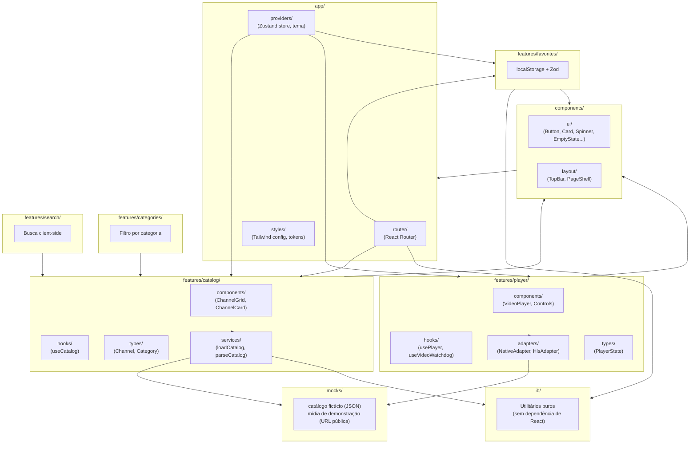

# Arquitetura Proposta — Implementação Própria

> **Importante:** esta é a arquitetura da **nossa** aplicação, uma proposta original. Ela é *informada* pelos requisitos funcionais aprendidos em `docs/reverse-engineering/`, mas nenhuma decisão aqui copia a implementação real do Saimo TV — em vários pontos, deliberadamente diverge dela (ver `decisions.md` para o porquê de cada escolha).

> **Nota de status (pós-Sprint 02):** a tabela de stack abaixo reflete o **planejamento inicial** (antes da Sprint 01). A arquitetura **real**, confirmada pelo usuário ao abrir a Sprint 01, é um monorepo Bun Workspaces com backend Hono desde o início (ver ADR-007/ADR-008 em `decisions.md`) — TanStack Query e Zustand já estão em uso desde a Sprint 01, não adiados como a tabela original sugeria. A Seção "Módulo de Catálogo (Sprint 02)", mais abaixo, descreve a arquitetura **efetivamente implementada e testada**.

## Stack proposta (com justificativa de inclusão/exclusão)

### Frontend — incluído desde o Sprint 01

| Tecnologia | Por quê | Quando |
|---|---|---|
| **React 18+ / TypeScript (strict)** | Base do projeto, tipagem forte exigida pela Etapa 7 | Sprint 01 |
| **Vite** | Build rápido, HMR, ecossistema maduro para React+TS | Sprint 01 |
| **Tailwind CSS** | Design tokens próprios (cores, espaçamento, tipografia) expressos como configuração, não CSS solto; acelera Sprint 01-02 sem framework de componentes pesado | Sprint 01 |
| **React Router** | MVP tem ≥3 seções navegáveis (catálogo, player, favoritos) com URLs próprias (deep-linking, botão voltar do navegador) — justificado, não é só "porque existe" | Sprint 01 |
| **Zustand** | Estado global pequeno e cross-cutting: conteúdo ativo, status do player, favoritos — precisa ser lido/escrito por componentes não aparentados (TopBar, Player, Catálogo) sem prop-drilling. Zustand foi escolhido sobre Context+`useReducer` (o padrão que a própria Saimo TV usa, confirmado na auditoria) **de propósito**: para a aluna experimentar as duas abordagens em projetos distintos e comparar o trade-off na prática (ver `decisions.md` ADR-003) | Sprint 04 (quando houver estado real para gerenciar) |
| **Zod** | Validação de fronteira: dados mock/JSON e leituras de `localStorage` passam por `parse()` antes de entrar no domínio — nunca confiar em dado externo sem validar (lição direta da auditoria: o Saimo TV faz `JSON.parse` com `try/catch` defensivo em vários pontos) | Sprint 02 (catálogo) |

### Frontend — propositalmente **adiado**

| Tecnologia | Por quê adiar | Critério para introduzir |
|---|---|---|
| **TanStack Query** | O MVP usa dados **locais/mock** (arquivo JSON estático) — não há requisição remota real para cachear/revalidar. Instalar agora seria "biblioteca para preencher checklist" (vedado na Etapa 7) | Quando (e se) introduzirmos uma fonte de dados remota real (ex.: um mock server ou API própria) |
| **Shaka Player** | Nenhuma necessidade de DASH/DRM identificada no MVP (usaremos HLS de demonstração) | Só se decidirmos demonstrar DASH como exercício de aprendizado dedicado |
| **Playwright (E2E)** | Precisa de uma aplicação com fluxos estáveis para valer a pena; introduzi-lo no Sprint 01 testaria uma tela que ainda vai mudar muito | Sprint 06, ou antes se um fluxo crítico (seleção → reprodução) estabilizar cedo |
| **NestJS / PostgreSQL** | Instrução explícita do usuário: não criar backend inicialmente | Só quando uma funcionalidade exigir de fato persistência compartilhada (não é o caso de favoritos locais) |
| **Tauri** | Instrução explícita do usuário: evolução futura, não nesta entrega | Após o MVP web estar estável |

### Streaming

- **HTML5 `<video>` nativo** como base sempre.
- **hls.js**, carregado condicionalmente (lazy), para tocar uma mídia de demonstração HLS pública e autorizada (ex.: streams de teste mantidos por projetos como Mux ou Apple para fins de desenvolvimento) — nunca uma fonte de TV/IPTV real.
- Arquitetura de adapter (`MediaSourceAdapter`) preparada desde o Sprint 03 para permitir adicionar outro engine depois **sem reescrever o player** — mas só implementamos hls.js + nativo no MVP.

## Princípios arquiteturais

- **Feature-based**: cada funcionalidade (`catalog`, `player`, `favorites`...) é uma pasta autocontida com seus próprios `components/`, `hooks/`, `types/`, `services/` — não uma divisão por "tipo técnico" (`components/`, `hooks/` globais misturando tudo).
- **Domínio ≠ Infraestrutura ≠ Apresentação**: tipos e regras de negócio (`types/`, funções puras) não importam React; hooks conectam domínio a estado/efeitos; componentes só renderizam e disparam eventos.
- **Baixo acoplamento**: features não se importam diretamente umas às outras — comunicam-se via estado global (Zustand) ou props explícitas no nível de composição (`app/`).
- **Erro é estado, não exceção silenciosa**: toda operação que pode falhar (carregar catálogo, iniciar player) expõe um estado `error` explícito consumido pela UI — nunca um `console.error` órfão.
- **Testável por padrão**: funções de domínio são puras sempre que possível (fáceis de testar sem mock de DOM); hooks isolam efeitos colaterais para serem testados separadamente da UI.

## Diagrama de arquitetura (proposta)



## Estrutura de diretórios (criada progressivamente, nunca antecipada)

```
src/
  app/
    providers/       # Zustand store(s), ThemeProvider
    router/           # definição de rotas
    styles/            # tailwind.config, tokens (cores, espaçamento)
  components/
    ui/                 # componentes puramente visuais, sem lógica de domínio
    layout/              # TopBar, PageShell, estrutura de página
  features/
    catalog/
      components/
      hooks/
      types/
      services/
    categories/
    search/
    player/
      components/
      hooks/
      adapters/
      types/
    favorites/
    preferences/
  lib/                  # funções utilitárias puras, sem dependência de React
  mocks/                 # dados fictícios + referência a mídia de demonstração
  tests/                  # setup global de testes (não os testes em si, que ficam junto do código)
```

> Conforme Etapa 4: nenhuma dessas pastas é criada vazia. Cada uma nasce no sprint onde seu primeiro arquivo é necessário (ver `backlog.md`).

## Tratamento de erros, loading e estados vazios (transversal)

Todo dado assíncrono (mesmo mock, que ainda assim passa por uma função `async` simulando I/O real) modela-se como:

```typescript
type AsyncState<T> =
  | { status: "idle" }
  | { status: "loading" }
  | { status: "success"; data: T }
  | { status: "error"; message: string };
```

Isso é **decisão de arquitetura própria**, não copiada de lugar nenhum — mas o *motivo* de adotá-la vem direto de uma lição da engenharia reversa: o Saimo TV trata explicitamente `loading`/`error` como estado de primeira classe no player (Fase 03), nunca como ausência de dado. Replicamos o *padrão*, não o *código*.

## Acessibilidade e responsividade (transversal, não uma feature separada)

- Elementos interativos sempre navegáveis por teclado (`tabIndex`, `:focus-visible` visível).
- Vídeo com `aria-label` descritivo; controles do player com `role="button"`/`aria-pressed` onde aplicável.
- Layout mobile-first com Tailwind (`sm:`/`md:`/`lg:`), sem duplicar componentes por breakpoint.

---

## Módulo de Catálogo (Sprint 02) — arquitetura efetivamente implementada

### Diagrama de fluxo de dados

Ver [`diagrams/catalog-data-flow.mmd`](./diagrams/catalog-data-flow.mmd) — sequência completa: `CatalogPage` → `useSearchParams` (URL) → `useChannels` (TanStack Query) → `httpClient` → Hono (`catalog.routes`) → `catalog.service` → `catalog.repository` → dados fictícios em memória, e a resposta validada por Zod voltando pelo mesmo caminho.

### Modelos de domínio (`packages/shared/src/schemas/catalog.ts`)

```typescript
Category  { id, name, slug, description }
Channel   { id, name, description, categoryId, thumbnail, isFeatured, status }
ChannelStatus = "available" | "coming_soon" | "unavailable"
ChannelListQuery  { search?, categoryId?, page, pageSize, sort }
ChannelListResponse = { items: Channel[], page, pageSize, total, totalPages }  // paginatedSchema<Channel>
```

Autorais — nasceram do backlog (`backlog.md`), não de nenhuma leitura do código-fonte do Saimo TV. `ChannelListQuery` é o **mesmo** schema usado para validar a query string no backend e para tipar os parâmetros no frontend (ver "Contratos compartilhados" abaixo).

### Organização do módulo de backend (`apps/api/src/modules/catalog/`)

| Arquivo | Responsabilidade | Depende de |
|---|---|---|
| `catalog.routes.ts` | Recebe a requisição HTTP, valida entrada (`zValidator`), chama o service, define status code | `catalog.service`, `catalog.schemas` |
| `catalog.service.ts` | Regra de negócio: busca (accent-insensitive), filtro por categoria, ordenação determinística, paginação | `catalog.repository`, `lib/normalize` |
| `catalog.repository.ts` | Única camada que sabe de onde os dados vêm — hoje um array em memória | `catalog.fixtures` |
| `catalog.fixtures.ts` | Os 5 categorias + 20 conteúdos fictícios (dados, não lógica) | — |
| `catalog.schemas.ts` | Reexporta os schemas Zod de `@saimotv/shared` usados pelas rotas | `@saimotv/shared` |
| `catalog.test.ts` | 14 testes cobrindo todos os endpoints e casos de erro | `app.ts` (via `app.request(...)`, sem porta de rede real) |

**Por que o service nunca importa `catalog.fixtures` diretamente** (só via `catalog.repository`): essa é exatamente a fronteira que permite, no futuro, trocar o array em memória por uma consulta Drizzle/PostgreSQL sem tocar em uma linha de `catalog.service.ts` — ver "Estratégia futura de persistência" abaixo.

### Contratos compartilhados em ação

```typescript
// packages/shared — definido uma vez
export const channelListQuerySchema = z.object({
  search: z.string().trim().min(1).max(100).optional(),
  categoryId: z.string().optional(),
  page: z.coerce.number().int().positive().default(1),
  pageSize: z.coerce.number().int().positive().max(50).default(12),
  sort: channelSortSchema.default("featured_first"),
});

// apps/api/src/modules/catalog/catalog.routes.ts — valida a query string recebida
zValidator("query", channelListQuerySchema, (result, c) => { /* ... */ })

// apps/web/src/app/pages/CatalogPage.tsx — interpreta os searchParams da URL
const query = channelListQuerySchema.parse(Object.fromEntries(searchParams));
```

O `z.coerce.number()` é o detalhe que faz isso funcionar nos dois lados: tanto a query string HTTP (`?page=2`) quanto o `URLSearchParams` do React Router chegam como **texto**, nunca como número — o mesmo schema resolve a conversão e a validação para ambos.

### Estratégia de cache (TanStack Query)

- `useCategories`: `staleTime: 5 min` — dado quase estático, não vale recarregar a cada navegação.
- `useChannels`: `staleTime: 30s` + `placeholderData: keepPreviousData` — mantém a página anterior visível (sem "flash" de loading) enquanto uma nova combinação de filtro/página carrega; `queryKey` inclui o objeto `query` inteiro, então cada combinação de busca+categoria+página+ordenação tem seu próprio slot de cache.
- `useChannel(id)`: `enabled: id.length > 0` — nunca dispara com um id vazio (ex.: durante a primeira renderização antes do React Router resolver `:id`).

### Decisões sobre estado: URL vs. Zustand vs. TanStack Query

| Estado | Onde mora | Por quê |
|---|---|---|
| Busca, categoria, página, ordenação | **URL** (`useSearchParams`) | É o que torna a busca reproduzível: recarregar a página (F5), usar voltar/avançar do navegador, ou compartilhar o link devolvem exatamente a mesma visão |
| Lista de categorias, lista de conteúdos, detalhe de um conteúdo | **TanStack Query** | É "server state" — pode ficar desatualizado, precisa de cache/retry/refetch, a fonte de verdade é a API |
| Modo de visualização (grade/lista) | **Zustand** (`catalogUiStore`) | Preferência pessoal de "como ver", não parte do que torna um link compartilhável — ninguém espera que um link force o modo de visualização de quem o recebe |

Nenhum desses três é duplicado em outro lugar — por exemplo, o resultado de `useChannels` nunca é copiado para uma store Zustand "só para garantir".

### Estratégia futura de persistência: trocando o repository em memória por Drizzle + PostgreSQL

A interface de `catalogRepository` (`findAllCategories`, `findAllChannels`, `findChannelById`) foi desenhada para ser **a mesma** independentemente de onde os dados vêm. Uma versão futura com Drizzle trocaria só a implementação:

```typescript
// Versão atual (Sprint 02)
export const catalogRepository = {
  findAllChannels(): Channel[] {
    return [...channelFixtures];
  },
  // ...
};

// Versão futura (ilustrativa — não implementada nesta sprint)
export const catalogRepository = {
  async findAllChannels(): Promise<Channel[]> {
    return db.select().from(channelsTable);
  },
  // ...
};
```

O que mudaria: (1) as funções passariam a ser `async` (hoje são síncronas, por serem só acesso a um array); (2) `catalog.service.ts` precisaria de `await` nas chamadas ao repository, mas **nenhuma regra de negócio mudaria** — filtro, busca, ordenação e paginação continuariam sendo responsabilidade do service, não do banco (ou, numa evolução posterior, parte disso poderia migrar para a query SQL — uma decisão a ser tomada quando o volume de dados justificar). O schema Zod (`Channel`, `Category`) viraria também o shape das tabelas Drizzle (`drizzle-zod` consegue gerar um a partir do outro). Essa troca **não está planejada para a Sprint 03** — fica registrada aqui como o caminho natural, não como tarefa agendada.

---

## Módulo de Player (Sprint 03) — arquitetura efetivamente implementada

### Diagrama

Ver [`diagrams/player-architecture.mmd`](./diagrams/player-architecture.mmd).

### Camadas (`apps/web/src/features/player/`)

| Camada | Arquivo(s) | Responsabilidade |
|---|---|---|
| Apresentação | `components/VideoPlayer.tsx`, `components/PlayerControls.tsx` | Renderiza `<video>` + overlays de loading/erro conforme `PlayerState`; nunca fala com `hls.js` diretamente |
| Orquestração | `hooks/useVideoPlayer.ts` | Cria/destrói o motor certo a cada troca de `src`, traduz eventos nativos do `<video>` em `PlayerState`, expõe `play`/`pause`/`toggleMute`/`setVolume` |
| Seleção de motor | `adapters/createAdapter.ts` | Decide nativo vs. hls.js testando a URL — mesma lógica (não o mesmo código) aprendida na Fase 03 da engenharia reversa (`isHls`/suporte nativo do navegador) |
| Motores | `adapters/nativeAdapter.ts`, `adapters/hlsAdapter.ts` | Implementam `MediaSourceAdapter` (`attach`/`destroy`) — intercambiáveis, o hook não sabe qual está em uso |
| Tipos | `types/player.ts` | `PlayerState`, `MediaSourceAdapter` — o contrato entre todas as camadas acima |
| Apoio | `lib/describeMediaError.ts`, `lib/demoStream.ts` | Tradução de `MediaError.code` → mensagem em português; constante da mídia de demonstração (ADR-005) |

### Ciclo de vida e eventos (o que é nativo do navegador vs. lógica própria)

🟢 **Nativo do `<video>`, só traduzido para `PlayerState`:** `canplay` → `paused` (pronto, aguardando o usuário dar play); `playing` → `playing`; `pause` → `paused`; `waiting` → `loading`; `ended` → `ended`; `error` → `error` (com `describeMediaError(video.error)`); `volumechange` → atualiza `isMuted`/`volume`.

🟢 **Lógica própria:** um evento sintético `hlsFatalError`, disparado pelo `hlsAdapter` via `video.dispatchEvent(new ErrorEvent(...))` quando o hls.js reporta um erro fatal — porque erros do hls.js nem sempre disparam o evento nativo `error` do elemento. Isso mantém um **único** lugar (`useVideoPlayer`) decidindo "o player está com erro", não importa se o erro veio do navegador ou da biblioteca.

🟢 **Guard de condição de corrida:** a flag `cancelled`, fechada sobre o escopo do `useEffect`, é o padrão documentado em `docs/reverse-engineering/learning.md` (item 15), reimplementado aqui de forma original: se `src` mudar de novo antes do `attach()` assíncrono (hls.js) terminar, a tentativa antiga nunca aplica seu resultado sobre o player do `src` novo.

### O que foi deliberadamente simplificado em relação ao observado no Saimo TV

Ver ADR-016: sem watchdogs de tempo, sem múltiplas fontes por conteúdo, sem fallback automático entre fontes — esses mecanismos (documentados em detalhe em `docs/reverse-engineering/findings.md`, E-020) ficam para uma evolução futura, quando o catálogo tiver mais de uma fonte por conteúdo para justificá-los.

### Lazy-loading confirmado pelo build

```
dist/assets/index-*.js   468.18 kB │ gzip: 145.32 kB   ← bundle principal
dist/assets/hls-*.js     595.01 kB │ gzip: 185.84 kB   ← hls.js, chunk separado
```

O `import("hls.js")` dinâmico dentro de `hlsAdapter.attach()` é o que garante esse chunk separado — qualquer navegação que nunca abra um vídeo HLS (ex.: só olhar o catálogo) nunca baixa esses 595 KB.

---

## Módulo de Favoritos (Sprint 04) — arquitetura efetivamente implementada

### Diagrama

Ver [`diagrams/favorites-flow.mmd`](./diagrams/favorites-flow.mmd).

### Camadas (`apps/web/src/features/favorites/`)

| Camada | Arquivo(s) | Responsabilidade |
|---|---|---|
| Domínio puro | `lib/toggleFavoriteIds.ts` | Função pura `(ids, id) => string[]` — adiciona/remove sem mutar o array recebido; não sabe nada de React, Zustand ou `localStorage` |
| Validação de fronteira | `lib/parseFavoriteIds.ts` | `z.array(z.string())`; qualquer shape inesperado cai para `[]` em vez de lançar |
| Estado + persistência | `store/favoritesStore.ts` | Zustand com middleware `persist`; `merge` customizado passa o dado lido do `localStorage` por `parseFavoriteIds` antes de aceitá-lo como estado inicial |
| Apresentação | `components/FavoriteButton.tsx` | Botão de estrela; `aria-pressed`; `preventDefault`/`stopPropagation` (necessário por ficar aninhado dentro do `<Link>` do `ChannelCard`) |
| Composição | `app/pages/CatalogPage.tsx`, `ChannelDetailPage.tsx`, `FavoritesPage.tsx` (novo) | Único lugar onde `favorites` e `catalog` se encontram — nenhuma das duas features importa a outra diretamente |

### O padrão "actions slot": como `favorites` toca `catalog` sem acoplamento direto

`ChannelCard` (da feature `catalog`) ganhou uma prop de composição:

```tsx
interface ChannelCardProps {
  channel: Channel;
  viewMode?: ViewMode;
  actions?: ReactNode; // slot de composição — catalog não sabe o que entra aqui
}
```

`catalog` nunca importa `features/favorites`. Quem decide o que passar em `actions` é a página (`app/pages/CatalogPage.tsx`), a camada de composição:

```tsx
<ChannelCard
  channel={channel}
  actions={<FavoriteButton channelId={channel.id} channelName={channel.name} />}
/>
```

Isso é a mesma regra já declarada na seção "Princípios arquiteturais" acima ("features não se importam diretamente umas às outras... comunicam-se via... props explícitas no nível de composição") — a Sprint 04 foi a primeira a efetivamente precisar dela, porque é a primeira vez que duas features (`catalog`, `favorites`) precisam aparecer juntas no mesmo elemento visual. Ver ADR-017 para as alternativas descartadas.

### Como `/favoritos` obtém dados completos a partir de uma lista de ids

`favoritesStore` guarda **só ids** (`string[]`), nunca uma cópia de `Channel`. A página `FavoritesPage` cruza esse estado de cliente com o estado de servidor já existente:

```tsx
const favoriteIds = useFavoritesStore((state) => state.favoriteIds);
const channelsQuery = useChannels({ page: 1, pageSize: 50, sort: "name_asc" });
const favoriteChannels = (channelsQuery.data?.items ?? []).filter((channel) =>
  favoriteIds.includes(channel.id),
);
```

Nenhum endpoint novo foi criado — o catálogo fictício inteiro (20 itens) cabe em uma página de `pageSize: 50`, então a mesma consulta já usada em `/catalogo` cobre `/favoritos`. Ver ADR-019 para os limites dessa decisão (quando deixaria de valer).

### Estado: onde cada coisa mora, atualizado

| Estado | Onde mora | Por quê |
|---|---|---|
| `favoriteIds` (lista de ids favoritados) | **Zustand + `persist`** (`favoritesStore`) | Precisa sobreviver a recarregamento de página (critério de aceitação do backlog, item 9) — nem URL nem TanStack Query fazem isso sozinhos |
| Dados completos de cada canal favoritado | **TanStack Query** (`useChannels`, já existente) | Continua sendo "server state"; `favorites` só referencia por id, nunca duplica o conteúdo |

### Validação de dado de `localStorage` corrompido (lição direta da auditoria de RE)

```typescript
const favoriteIdsSchema = z.array(z.string());

export function parseFavoriteIds(raw: unknown): string[] {
  const result = favoriteIdsSchema.safeParse(raw);
  return result.success ? result.data : [];
}
```

Usado dentro do `merge` do `persist` — se o `localStorage` tiver JSON inválido, ou um shape inesperado (ex.: de uma versão antiga do schema, ou editado manualmente pelo usuário via DevTools), a store cai para lista vazia em vez de quebrar a aplicação. Ver ADR-018.

---

## Módulo de Experiência Avançada do Player — Atalhos de Teclado e Modo Cinema (Sprint 05)

### Escopo escolhido entre os itens "Opcional" do backlog

`backlog.md` deixa o Sprint 05 deliberadamente em aberto ("não iniciado sem decisão explícita sobre quais itens 'Opcionais' entram"). Desta sprint, foram escolhidos **atalhos de teclado** e **modo cinema** — ver ADR-020 para a justificativa completa de por que esses dois e não Picture-in-Picture, espelhamento de tela, navegação por D-pad, EPG sintético ou layout dedicado para TV.

### Camadas (`apps/web/src/features/player/`)

| Camada | Arquivo(s) | Responsabilidade |
|---|---|---|
| Domínio puro | `lib/mapKeyToAction.ts` | Função pura `(key: string) => PlayerShortcutAction \| null` — só traduz uma tecla em uma intenção; não sabe nada de `<video>`, React ou Zustand |
| Estado de UI (não persistido) | `store/playerUiStore.ts` | Zustand simples, `isTheaterMode: boolean` — mesmo padrão já usado em `catalogUiStore.viewMode`: preferência de "como ver", não persistida, porque não é algo que se espera encontrar ligado ao reabrir a aplicação |
| Apresentação/orquestração | `components/VideoPlayer.tsx` | Único lugar que liga as duas peças: um `onKeyDown` no contêiner do player chama `mapKeyToAction`, e despacha para as ações já existentes do `useVideoPlayer` (`play`/`pause`/`toggleMute`/`setVolume`) ou para `toggleTheaterMode` |
| Apresentação | `components/PlayerControls.tsx` | Ganhou um botão "Modo cinema" / "Sair do modo cinema" (`aria-pressed`), ao lado dos controles já existentes |
| Composição | `app/pages/ChannelDetailPage.tsx` | Lê `useIsTheaterMode()` e alarga o próprio contêiner da página (`max-w-2xl` → `max-w-5xl`) quando ativo — o player não decide o layout da página ao redor dele, só expõe o estado |

### Atalhos implementados

| Tecla | Ação | Observação |
|---|---|---|
| `Espaço` | play/pause | Reaproveita exatamente `play()`/`pause()` já expostos pelo hook da Sprint 03 |
| `↑` / `↓` | volume +10% / −10% | Clampado entre 0 e 1 (`Math.min`/`Math.max`); chama o mesmo `setVolume()` já usado pelo slider |
| `M` | mudo/ativar som | Reaproveita `toggleMute()` já existente |
| `T` | modo cinema | Única ação nova de estado (`playerUiStore`) |

O `onKeyDown` fica num `<div role="group" tabIndex={0}>` que envolve o `<video>` — os atalhos só funcionam quando esse contêiner (ou algo dentro dele) está focado, nunca globalmente no `document`. Isso evita o problema clássico de atalhos de player "roubarem" teclas de outros elementos da página (ex.: espaço dentro de um campo de busca).

### Por que nenhum endpoint, schema ou estado de servidor novo foi necessário

Atalhos de teclado e modo cinema são 100% estado de **apresentação/cliente** — nenhum dos dois precisa saber nada sobre o catálogo, a API ou favoritos. Por isso esta seção não tem "Decisões sobre estado: URL vs. Zustand vs. TanStack Query" própria: `isTheaterMode` é o único estado novo, e já está coberto pela mesma lógica da tabela de favoritos ("preferência pessoal → Zustand, não persistido").

### Problema real encontrado e corrigido: `video.play()` nem sempre devolve uma `Promise`

Ao escrever o primeiro teste que de fato chama `play()` através de um atalho de teclado (nenhum teste anterior clicava no botão "Reproduzir"), `bun run test` revelou que `video.play().catch(...)` em `useVideoPlayer.ts` quebra em ambientes onde `HTMLMediaElement.prototype.play()` não devolve uma `Promise` (confirmado isoladamente: `jsdom@25` devolve `undefined`). A especificação do DOM garante uma `Promise` em navegadores reais, mas o código não deveria depender silenciosamente disso. Corrigido envolvendo a chamada em `Promise.resolve(...)` nas duas tentativas (com som e, se falhar, mudo) — mesmo comportamento em produção, mais robusto em qualquer ambiente de teste.
