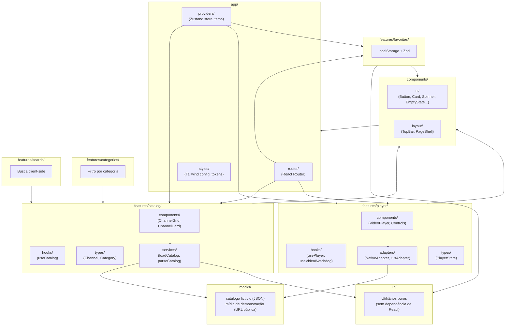

# Arquitetura Proposta — Implementação Própria

> **Importante:** esta é a arquitetura da **nossa** aplicação, uma proposta original. Ela é *informada* pelos requisitos funcionais aprendidos em `docs/reverse-engineering/`, mas nenhuma decisão aqui copia a implementação real do Saimo TV — em vários pontos, deliberadamente diverge dela (ver `decisions.md` para o porquê de cada escolha).

## Stack proposta (com justificativa de inclusão/exclusão)

### Frontend — incluído desde o Sprint 01

| Tecnologia | Por quê | Quando |
|---|---|---|
| **React 18+ / TypeScript (strict)** | Base do projeto, tipagem forte exigida pela Etapa 7 | Sprint 01 |
| **Vite** | Build rápido, HMR, ecossistema maduro para React+TS | Sprint 01 |
| **Tailwind CSS** | Design tokens próprios (cores, espaçamento, tipografia) expressos como configuração, não CSS solto; acelera Sprint 01-02 sem framework de componentes pesado | Sprint 01 |
| **React Router** | MVP tem ≥3 seções navegáveis (catálogo, player, favoritos) com URLs próprias (deep-linking, botão voltar do navegador) — justificado, não é só "porque existe" | Sprint 01 |
| **Zustand** | Estado global pequeno e cross-cutting: conteúdo ativo, status do player, favoritos — precisa ser lido/escrito por componentes não aparentados (TopBar, Player, Catálogo) sem prop-drilling. Zustand foi escolhido sobre Context+`useReducer` (o padrão que a própria Saimo TV usa, confirmado na auditoria) **de propósito**: para a aluna experimentar as duas abordagens em projetos distintos e comparar o trade-off na prática (ver `decisions.md` ADR-003) | Sprint 04 (quando houver estado real para gerenciar) |
| **Zod** | Validação de fronteira: dados mock/JSON e leituras de `localStorage` passam por `parse()` antes de entrar no domínio — nunca confiar em dado externo sem validar (lição direta da auditoria: o Saimo TV faz `JSON.parse` com `try/catch` defensivo em vários pontos) | Sprint 02 (catálogo) |

### Frontend — propositalmente **adiado**

| Tecnologia | Por quê adiar | Critério para introduzir |
|---|---|---|
| **TanStack Query** | O MVP usa dados **locais/mock** (arquivo JSON estático) — não há requisição remota real para cachear/revalidar. Instalar agora seria "biblioteca para preencher checklist" (vedado na Etapa 7) | Quando (e se) introduzirmos uma fonte de dados remota real (ex.: um mock server ou API própria) |
| **Shaka Player** | Nenhuma necessidade de DASH/DRM identificada no MVP (usaremos HLS de demonstração) | Só se decidirmos demonstrar DASH como exercício de aprendizado dedicado |
| **Playwright (E2E)** | Precisa de uma aplicação com fluxos estáveis para valer a pena; introduzi-lo no Sprint 01 testaria uma tela que ainda vai mudar muito | Sprint 06, ou antes se um fluxo crítico (seleção → reprodução) estabilizar cedo |
| **NestJS / PostgreSQL** | Instrução explícita do usuário: não criar backend inicialmente | Só quando uma funcionalidade exigir de fato persistência compartilhada (não é o caso de favoritos locais) |
| **Tauri** | Instrução explícita do usuário: evolução futura, não nesta entrega | Após o MVP web estar estável |

### Streaming

- **HTML5 `<video>` nativo** como base sempre.
- **hls.js**, carregado condicionalmente (lazy), para tocar uma mídia de demonstração HLS pública e autorizada (ex.: streams de teste mantidos por projetos como Mux ou Apple para fins de desenvolvimento) — nunca uma fonte de TV/IPTV real.
- Arquitetura de adapter (`MediaSourceAdapter`) preparada desde o Sprint 03 para permitir adicionar outro engine depois **sem reescrever o player** — mas só implementamos hls.js + nativo no MVP.

## Princípios arquiteturais

- **Feature-based**: cada funcionalidade (`catalog`, `player`, `favorites`...) é uma pasta autocontida com seus próprios `components/`, `hooks/`, `types/`, `services/` — não uma divisão por "tipo técnico" (`components/`, `hooks/` globais misturando tudo).
- **Domínio ≠ Infraestrutura ≠ Apresentação**: tipos e regras de negócio (`types/`, funções puras) não importam React; hooks conectam domínio a estado/efeitos; componentes só renderizam e disparam eventos.
- **Baixo acoplamento**: features não se importam diretamente umas às outras — comunicam-se via estado global (Zustand) ou props explícitas no nível de composição (`app/`).
- **Erro é estado, não exceção silenciosa**: toda operação que pode falhar (carregar catálogo, iniciar player) expõe um estado `error` explícito consumido pela UI — nunca um `console.error` órfão.
- **Testável por padrão**: funções de domínio são puras sempre que possível (fáceis de testar sem mock de DOM); hooks isolam efeitos colaterais para serem testados separadamente da UI.

## Diagrama de arquitetura (proposta)



## Estrutura de diretórios (criada progressivamente, nunca antecipada)

```
src/
  app/
    providers/       # Zustand store(s), ThemeProvider
    router/           # definição de rotas
    styles/            # tailwind.config, tokens (cores, espaçamento)
  components/
    ui/                 # componentes puramente visuais, sem lógica de domínio
    layout/              # TopBar, PageShell, estrutura de página
  features/
    catalog/
      components/
      hooks/
      types/
      services/
    categories/
    search/
    player/
      components/
      hooks/
      adapters/
      types/
    favorites/
    preferences/
  lib/                  # funções utilitárias puras, sem dependência de React
  mocks/                 # dados fictícios + referência a mídia de demonstração
  tests/                  # setup global de testes (não os testes em si, que ficam junto do código)
```

> Conforme Etapa 4: nenhuma dessas pastas é criada vazia. Cada uma nasce no sprint onde seu primeiro arquivo é necessário (ver `backlog.md`).

## Tratamento de erros, loading e estados vazios (transversal)

Todo dado assíncrono (mesmo mock, que ainda assim passa por uma função `async` simulando I/O real) modela-se como:

```typescript
type AsyncState<T> =
  | { status: "idle" }
  | { status: "loading" }
  | { status: "success"; data: T }
  | { status: "error"; message: string };
```

Isso é **decisão de arquitetura própria**, não copiada de lugar nenhum — mas o *motivo* de adotá-la vem direto de uma lição da engenharia reversa: o Saimo TV trata explicitamente `loading`/`error` como estado de primeira classe no player (Fase 03), nunca como ausência de dado. Replicamos o *padrão*, não o *código*.

## Acessibilidade e responsividade (transversal, não uma feature separada)

- Elementos interativos sempre navegáveis por teclado (`tabIndex`, `:focus-visible` visível).
- Vídeo com `aria-label` descritivo; controles do player com `role="button"`/`aria-pressed` onde aplicável.
- Layout mobile-first com Tailwind (`sm:`/`md:`/`lg:`), sem duplicar componentes por breakpoint.
